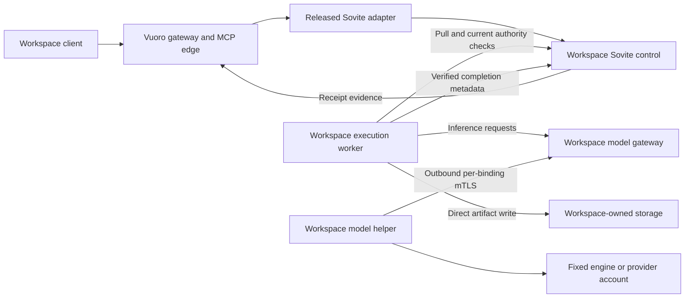

# Publishing Sovite over vuoro-cloud as a workspace-owned capability

Status: **direction accepted 2026-10-20; design proposed.** Operator direction: BYO models are a Sovite
concept; vuoro-cloud publishes Sovite to workspaces as a composed coordination capability. Vuoro gets no
model concept and Sovite is not a model-provider service. Nothing here authorizes Terraform, Flux,
cluster, public endpoint or DNS changes; the vuoro-cloud hold and its signed-promotion rules still apply.
Depends on [remote model hosting](2026-10-20-sovite-remote-model-hosting.md) R1–R8.
Planner: Codex, read-only. Source brief sha256 prefix `31c104b20e6c952b`; links rewritten as `repo:path`.

**Recommendation:** publish a dedicated Sovite capability for each workspace. Cloud hosts its coordination and admission services; workspace-owned hosts run execution, hold provider credentials, and write private artifacts directly to workspace storage. Sovite owns every model binding, grant, qualification, queue, and execution decision. Vuoro records work, authority, and evidence through a released Sovite adapter.

This requires additional Sovite work beyond the accepted remote-model brief. Its inference-only helper does not solve tenant isolation, caller delegation, or BYO artifact custody.

**Goal and scope.** A workspace owner can configure and qualify Sovite, enroll its own model hosts or provider-account helpers, request bounded work against an explicit Sovite grant, and connect the resulting receipt to Vuoro work. Workspace members retrieve private artifacts using separately authorized workspace storage access.

The initial supported profile excludes hosted customer code, protected tools, Cloud-held provider/S3 credentials, automatic model selection or fallback, shared Sovite tenancy, and local-only content passing through Cloud.

This is a read-only design based on local checkouts: Sovite `510ceb81a0bd`, Vuoro `aa5af4de351f`, Cloud `a0245983ac9a`, and AgentOps `f38a013176b8`. No files changed, tests ran, or deployment probes occurred. The checked-out status record says rollout is **held since 2026-10-13**; that is a dated source record, not a fresh live observation. [Status record](vuoro-cloud:IMPLEMENTATION-STATUS.md:16)

**Verified constraints and their consequences.**

| Constraint | Design consequence |
|---|---|
| TS-2 and KAOS retain native execution/model choice; local-only data excludes remote inference. | Vuoro carries an opaque Sovite capability reference and observed profile digest. Binding selection remains inside Sovite. A private helper does not make a Cloud-mediated content path local-only. [TS-2](agentops:docs/plans/2026-09-17-target-state.md:82), [KAOS boundary](agentops:docs/plans/agentops/2026-10-18-kaos-2028-roadmap.md:95) |
| D-016/D-017 require BYO artifacts and keep user S3 credentials outside Cloud. The executive boundary also leaves model credentials and execution hosts with users. | Provider keys remain on helpers; storage keys remain on workspace execution/storage hosts. Cloud cannot simply deploy Sovite’s default artifact store. [Decisions](vuoro-cloud:17-DECISION-LOG.md:20), [BYO artifacts](vuoro-cloud:05-BYO-S3-ARTIFACTS.md:3), [User ownership](vuoro-cloud:00-EXECUTIVE-DECISION.md:33) |
| Cloud composes released owner capabilities. | Sovite must release the hosting, identity, and custody contracts before Cloud consumes them. No copied Sovite policy logic in Cloud. [Distribution ownership](vuoro-cloud:20-PRODUCT-DISTRIBUTION-PLAN.md:7) |
| Workspace is the tenant boundary; namespace/runtime/database derive from authenticated identity. | Capability placement is server-selected. Clients cannot supply another tenant’s namespace, endpoint, or database. [Tenancy contract](vuoro-cloud:03-TENANCY-IDENTITY-AND-AUTHORIZATION.md:3) |
| Tenant networking defaults to deny. | No Internet egress exception for model hosts or providers. **Correction:** current required egress includes DNS **and PostgreSQL**, not DNS alone. [Rendering](vuoro-cloud:src/vuoro_cloud/tenant.py:334) |
| Gateway assertions are Ed25519 with a 30-second lifetime; MCP checks current membership, grants, and scope. | Reuse this trust pattern with a Sovite-specific audience and explicit delegation. Precisely, the assertion lifetime is D-025; D-046 defines the MCP resource-server behavior. [Assertion implementation](vuoro-cloud:src/vuoro_cloud/security.py:68), [Decision log](vuoro-cloud:17-DECISION-LOG.md:29) |
| Sovite qualifications bind generation and runtime; C0–C3 govern placement; callers receive receipts only. | Preserve whole-generation qualification and receipt-only MCP. Add hosting-specific enforcement rather than weakening these contracts. [Platform contract](sovite:docs/PLATFORM-SPEC.md:68), [Classes](sovite:docs/PLATFORM-SPEC.md:110), [Receipt boundary](sovite:docs/PLATFORM-SPEC.md:139) |

**Decisions.** These recommendations define the implementation target.

| Topic | Recommendation and justification | Alternatives |
|---|---|---|
| Sovite tenancy | **One instance per workspace in its existing `vuoro-ws-*` namespace**, with separate service accounts, workload labels, trust, configuration, and quotas. This aligns lifecycle and controller authority with existing tenancy. | A sibling namespace gives cleaner namespace-wide resource separation but expands provisioning/admission scope. Shared Sovite saves idle memory but requires pervasive tenant-aware authorization, storage, queues, caches, and qualification; reject for the initial distribution. |
| Database placement | Add a **Sovite-owned schema and dedicated migration/runtime roles inside the workspace database**. Give neither role access to work/audit schemas. | A separate Sovite database offers another logical boundary but adds provisioning and restore complexity. Per-workspace PostgreSQL servers waste resources on one node. |
| Hosted components | Run Sovite control/admission and model gateway. Disable bundled PostgreSQL, Garage, Ollama, Cloud workers, native harnesses, and Kubernetes tools. | Deploying the full default chart introduces hosted execution and artifact custody beyond Cloud’s current boundary. |
| Bundle authorship | **Workspace owner authors policy**, through an owner-supplied Sovite UI/API exposed by Cloud. Cloud controls the hosting envelope: placement, resource ceilings, permitted packages, data classes, and networking. | Operator-authored tenant bundles create a permanent support bottleneck and blur responsibility for tenant clearances. |
| Qualification | Require **both platform and workspace qualification**, with role-scoped signing keys outside the cluster. Cloud qualifies hosting/isolation; the workspace qualifies its bindings, retention, execution host, and competence. | A Cloud workstation key cannot speak for tenant-owned bindings. Tenant self-signing alone cannot establish Cloud isolation. |
| Invocation | Use a **Sovite-owned adapter built with `vuoro-adapter-kit`**, consumed as a pinned release. MCP edge offers explicit request/status tools with strict schemas and bounded output. | Raw MCP passthrough weakens catalog, authorization, and disclosure controls. Avoid a second task state machine in Vuoro. |
| Private artifacts | **Workspace-side execution writes directly to BYO storage** and publishes verified metadata. Cloud stores neither artifact bytes nor storage credentials. | A Cloud worker uploading through a tenant storage proxy still puts Cloud in the artifact path. Operator-owned hosted artifact storage would require a separate custody-mode decision. |
| Model connectivity | Retain the accepted design: **one binding per outbound mTLS helper connection**, terminating at the workspace’s Sovite model gateway. | Direct Cloud-to-host calls require per-host egress and reachability changes. Shared authenticated model routing is unnecessary. |
| Provider accounts | Run the provider adapter on the workspace helper host; keys stay there. Advertise enforced support only when that provider meets Sovite’s identity, retention, and cancellation requirements. | A provider’s model name cannot be presented as verified weight identity. Cloud-held provider keys contradict the custody boundary. |
| Initial data policy | Permit **C0 and explicitly approved C1 only** throughout hosted processing. Reject C2/C3 and all local-only content in this profile. | Higher classes require a separately qualified placement/retention profile. Local-only work requires the entire content-bearing Sovite path outside Cloud. |

Per-workspace instances cost more idle RAM and connections than shared Sovite, but avoid making multi-tenancy a new Sovite security substrate. Removing hosted inference, workers, and object storage controls the larger costs. Sharing the existing PostgreSQL cluster and a transport-only L4 edge is reasonable; sharing task admission or model-gateway sessions is not.

The current chart requests 100m CPU/128Mi for control, but gateway and additional service costs remain unmeasured. Review the current namespace quota before packaging; do not infer node capacity from chart requests. Start with one active workspace and one concurrent task/binding, then measure memory, connections, recovery, and operator effort. Namespace isolation does not isolate kernel, node, database-server, or storage failure. [Chart defaults](sovite:deploy/helm/sovite/values.yaml:24), [Workspace quotas](vuoro-cloud:src/vuoro_cloud/tenant.py:277)

**Component boundaries.** The distribution has two distinct workspace-side processes. They may share a host initially, but must not share identity or credentials.



| Component | Owns | Must not acquire |
|---|---|---|
| Vuoro | Work/run identity, delegation references, evidence correlation, acceptance | Model catalog, model selection, fallback, Sovite queue/retry logic |
| Cloud | Workspace identity, capability lifecycle, routing, hosting envelope, release pins | Tenant provider/S3 credentials, model policy semantics, customer execution |
| Sovite | Bundle compiler, resolved task bindings, grants, qualification, execution leases, model permits, receipts | Vuoro work acceptance or protected-effect authority |
| Workspace execution worker | Fixed released harness, local authorization, artifact creation/upload, completion evidence | Cloud DB access, cluster access, qualification signing key |
| Model helper | One binding’s inference connection, engine/provider access, signed identity and cancellation | Task execution, tools, arbitrary tunneling, artifact storage authority |

The workspace-side execution worker is **new scope**, separate from the accepted inference-only helper. It needs a narrow Sovite lease API rather than remote database access. Its allowed operations are claim, renew, cancel observation, and fenced completion with artifact metadata. Execution remains Sovite-owned and workspace-operated; Vuoro does not assign or supervise it.

This addition is required because today Sovite persists task input in its database and writes full results through its configured artifact backend. The existing external harness also returns full results to the worker. Receipt-only caller output does not change those internal custody facts. [Task persistence](sovite:sovite/service.py:102), [Current external harness/result contract](sovite:docs/API_CONTRACT.md:21)

**Bundle, compilation, and qualification lifecycle.**

1. **Author a draft.** Workspace owners create agents, bindings, grants, classifications, and retention declarations in Sovite. An admin may operate an already approved configuration; ordinary membership does not confer policy-authoring authority. The first release has no onward delegation.
2. **Compile without execution.** Sovite parses strict bounded input, resolves references, and applies its class/placement checks. A hosted-profile compiler additionally rejects tenant-selected namespaces, arbitrary images/executables, host paths, privileged settings, direct model endpoints, Cloud secret references, protected tools, and hosted classes above C1.
3. **Bind the hosting envelope.** Cloud supplies workspace identity and approved placement/resource policy through a versioned owner-defined contract. Sovite owns the validation semantics. The resulting digest includes the envelope; a bundle cannot label itself into greater Cloud clearance.
4. **Stage and observe.** Render pinned artifacts, run explicit migrations, and activate the generation with grants inhibited. Observe the actual runtime, network policy, external worker, helper, storage placement, and stop behavior.
5. **Qualify and enable.** Verify both required signature roles against the same workspace, generation, runtime/deployment bindings, and hosted-policy revision. Any failed, missing, expired, or revoked qualification keeps dispatch disabled.

Use a tenant-controlled Ed25519 qualification key on a separate owner-controlled signing device or workstation—not in Cloud, the helper process, or the execution worker. Cloud uses a separate outside-cluster platform qualification key. Neither is the Cloud release-promotion key.

Cloud signs platform identity, isolation, lifecycle, and recovery evidence. The tenant signs binding identity, host/provider retention, artifact placement, competence, and tenant-side recovery evidence. The effective qualification requires both; one signer cannot substitute for the other. Reuse measurements only through an explicitly referenced evidence set in a newly valid qualification.

This needs a Sovite change: the current verifier accepts a qualifying record from any trusted key without signer-role separation. Also extend the runtime fingerprint to include the explicit database schema and remote execution/artifact bindings. [Current qualification logic](sovite:sovite/qualification.py:19), [Trusted-key acceptance](sovite:sovite/qualification.py:86)

Preserve whole-generation qualification initially. Bundle edits inhibit superseded work and require qualification of the new generation. Restore never resumes authority automatically. [Generation behavior](sovite:docs/PLATFORM-SPEC.md:161), [Recovery requirements](sovite:docs/OPERATIONS.md:108)

**Invocation, identity, and evidence.** A work item invokes Sovite only through an explicit request containing its authorized work/run reference, Sovite grant reference, bounded task input, classification, and idempotency key. Merely changing work status must not dispatch a task.

The public tool is a **request/proposal**. Sovite admits it under a configured grant; the workspace-side worker pulls it and independently checks current local authority. The request cannot carry its own authority to execute protected effects. This preserves the accepted pull-based protected boundary. [Product direction](vuoro:docs/direction/2026-10-15-product-direction.md:11)

The identity contract should be:

- Map the verified issuer, subject, principal epoch, and workspace into a stable opaque Sovite caller identifier; keep provenance privately.
- Intersect current Cloud capability entitlement, token authority, repository/work binding, and Sovite grant authority. A model name or workspace role alone grants nothing.
- Add a narrow gateway exchange for a fresh **30-second Sovite-audience assertion**, bound to workspace, principal, request, capability instance, operation, and request digest. The runtime adapter authenticates as its own workload; it cannot choose arbitrary destinations or broaden authority.
- Keep signing keys out of MCP edge. Do not forward user bearer tokens, replay the Vuoro-audience assertion as a Sovite credential, or use one shared Sovite caller token for the workspace.
- Recheck current principal entitlement at admission, execution authorization, permit renewal, and release. An unavailable currentness service fails closed.

Sovite’s existing named caller tokens and single operator role are insufficient for this delegation model. [Current authentication](sovite:sovite/api.py:44) The adapter kit supplies metadata/admission structures, not authentication or authority by itself. [Adapter-kit contract](vuoro:packages/vuoro-adapter-kit/README.md:1)

Public MCP responses remain exactly opaque receipt plus bounded status. No result, result URL, provider task identifier, private job identity, or model-generated error escapes. Artifact locators are available only through a separate workspace-authorized metadata interface; an authorized client retrieves bytes directly from storage and verifies the digest. Workspace membership does not itself replace S3 authorization.

The execution worker publishes completion only after direct upload and read-back/hash verification. Sovite rechecks its lease fence and current authority before marking the receipt available. Vuoro records the receipt, owner/generation references, artifact digest where authorized, attempt correlation, freshness, and evidence class. It does not convert completion into acceptance or introduce model fields into its contracts. [Receipt contract](sovite:docs/API_CONTRACT.md:13), [Evidence classes](vuoro:docs/direction/2026-10-15-product-direction.md:82)

Keep the existing empty work-resource observer grant policy empty. Enabling Sovite must not incidentally authorize cross-repository observation. [Fail-closed policy](vuoro-cloud:src/vuoro_cloud/tenant.py:55)

**BYO enrollment and network exposure.** Preserve the accepted remote-hosting brief’s Phase 2 enrollment contract: locally generated helper key; owner-approved CSR for one workspace installation/binding/role; 24-hour leaf certificate; renewal around 12 hours; explicit session fencing on replacement; revocation checked during connection, request authorization, and permit renewal.

Cloud authenticates workspace ownership; Sovite owns enrollment semantics. Use a workspace-scoped helper intermediate and a separately isolated issuer. Keep helper transport PKI, execution-worker PKI, qualification keys, and release signing distinct. A helper certificate cannot authenticate as a worker or caller.

For external dial-in, recommend a **shared L4 TCP edge with workspace SNI routing and TLS passthrough to dedicated workspace gateways**. The model gateway terminates and validates helper mTLS. SNI selects a destination; it grants no authority. Wrong-workspace certificates must fail before prompt delivery.

This introduces an external transport path beyond the current tunnel-only PoC shape. Treat it as an explicit hosting decision and separately authorized operational change. Do not assume an HTTP tunnel preserves end-to-end client certificates.

There is **no new public-Internet egress** from tenant pods. Required internal allows still change: adapter-to-Sovite, gateway-to-control, identity-currentness checks, and Sovite-to-workspace PostgreSQL. Helpers and external execution workers initiate their connections. Return traffic uses those connections.

The hosted Sovite profile should use internal service destinations only. Do not copy direct `modelPeers`, `modelCredentials`, provider egress, or arbitrary tool paths from the current chart. Its strict DNS/Cilium assumptions also require an explicit compatibility decision: implement a qualified service-only profile with no external DNS requirement rather than silently disabling strict networking. [Current chart assumptions](sovite:deploy/helm/sovite/values.yaml:98)

For provider accounts, the helper performs validated HTTPS calls to its fixed approved provider. Provider keys, provider-side diagnostics, and provider account administration stay on that host. The accepted brief’s provider limitations remain binding: insufficient identity or cancellation evidence means **no enforced-provider claim**.

**PR sequence and evidence.** Use sequential single-PR planning, not wave dispatch. Each PR freezes its interface and refusal cases before its consumer starts. These identifiers are proposed work labels, not created tracker items.

The existing remote-hosting PRs remain **R1–R8**, unchanged: schema; protocol/identity; gateway authority; worker/native integration; Phase 1 deployment; Phase 2 enrollment; remote qualification/demand; transitional-path retirement. Remote tenant use requires the completed relevant path through R8, not merely the schema currently being built.

| Repo / PR | Bounded change | Required evidence |
|---|---|---|
| **AgentOps A1 — planning provenance** | Import a sanitized, hash-identified copy of the accepted remote brief into Git; record this hosting dependency and sourcing boundary. | Source resolves in Git; no private topology; TS-2/KAOS alignment. The supplied `/tmp` brief is currently session-local. |
| **Sovite S1 — hosted persistence lifecycle** | Explicit migration/check commands; configurable isolated schema; runtime role without DDL; startup compatibility checks. Reuse R1 migration work where applicable. | SQLite/PostgreSQL upgrade and refusal tests; runtime fails against unmigrated schema; denied cross-schema access; no startup DDL. Current `create_all()` must leave the hosted startup path. [Current initialization](sovite:sovite/db.py:134) |
| **Sovite S2 — hosted policy and qualification** | Versioned hosting envelope; bundle author/activator roles; scoped qualification issuers; signed qualification import/export; expanded runtime binding. | Hostile bundle negatives; tenant signature cannot satisfy platform role; cross-workspace replay, changed placement, expired/revoked key, and incomplete evidence all refuse dispatch. |
| **Sovite S3 — caller delegation and owner adapter** | Sovite assertion verifier, stable caller mapping, narrow administration scopes, owner adapter using the released kit. | Wrong audience/workspace/repository, replay, authority expansion, operator-path bypass, and revoked principal tests; caller-private receipt tests. |
| **Sovite S4 — external execution lease API** | Narrow pull/renew/cancel/complete protocol; separate worker identity; fences and metadata-only completion. | No DB credentials on worker; duplicate claims/completions; late worker refusal; partitions; cancellation; uncertain execution retained without blind replay. |
| **Sovite S5 — BYO artifact worker** | Package the external worker with direct storage writing and verified artifact receipts. Keep inference helper unchanged. | Real direct upload/read-back; credential absence from Cloud; interrupted upload/completion recovery; no artifact body or presigned URL in Cloud DB/logs. |
| **Sovite S6 — hosted chart profile** | Compose control/gateway against existing database; external execution/artifacts; disable bundled services; strict networking and deployment binding. | Helm positives/negatives; no privileged resources or provider keys; actual packet isolation; deployment changes invalidate qualification. Requires R5–R8 as applicable. |
| **Vuoro V1 — released composition** | Consume the released Sovite adapter; add optional capability descriptor and compatibility pins. No model fields or domain logic in client/kit. | Owner-adapter conformance; capability absent on older composition; boundary tests; exact wheel hashes and supported tuple. |
| **Vuoro V2 — work/evidence surface** | Explicit request/status tools and receipt correlation through existing work/run/evidence contracts. | Unauthorized work links denied; retries yield one logical task/evidence link; exact output schema; result leakage refused; completion never auto-accepts work. |
| **Cloud C1 — capability lifecycle** | Workspace capability state/configuration references, scoped management endpoints, Sovite schema roles, idempotent provisioning, quota/rendering changes. | Two-workspace provisioning; namespace collision tests; runtime/migration separation; hold/delete/restore remain inhibited. No model tables in control DB. |
| **Cloud C2 — delegated identity** | Restricted Sovite-audience assertion exchange, capability scopes, principal currentness service. | Role/scope intersection; removal during execution; wrong target/body; replay; currentness outage fails closed; edge gains no credential. |
| **Cloud C3 — connector exposure** | Reviewed L4 routing and worker/helper listeners, independent trust domains, internal policy additions and connection limits. | Real external NAT-host dial-in; wrong SNI/cert/binding; no reverse routing; flood/backpressure and revocation tests. Merge does not authorize deployment. |
| **Cloud C4 — qualification and supported onboarding** | Bundle/signature/enrollment UX, retention/deletion/export, diagnostics, support ownership, rollback and recovery collectors. | Fresh owner onboards without manual SQL/Secrets edits; two-tenant leakage tests; restart, failed upgrade, export and restore; measured support/cost denominator. |
| **Cloud C5 — release candidate and pilot evidence** | Exact released composition pins, migration/rollback package, runbooks, capability disabled by default. | Repository release gate, independent reviews, signed promotion and—only after authorization—actual image/schema/route observations and pilot evidence. |

Attach this work to the existing [distribution plan](vuoro-cloud:20-PRODUCT-DISTRIBUTION-PLAN.md:15):

- **Items 1–2:** current-state reconciliation, held-rollout qualification, restore, migration and rollback.
- **Item 3 / CL-K01:** first usable scoped task and durable work/result link.
- **Items 4–6 / CL-K04:** capacity, support, supported composition, onboarding, export and upgrade.
- **Item 7 / CL-K05:** tenant-owned policy, enrollment, consent, isolation and credential custody.
- **Item 8:** the concrete caller/workload trust map and its adversarial qualification.
- **CL-K02:** derived missing-receipt, disconnected-helper, expired-qualification and held-capability observations. No new acknowledgment state.

Propose **distribution item 9 / CL-K06: “Workspace-owned Sovite capability”**, dependent on the above owner contracts and holding the end-to-end acceptance criteria. This prevents scattering the actual deliverable across generic distribution items. CL-K03 attention lifecycle is not a prerequisite for the internal slice. [KAOS item definitions](vuoro-cloud:docs/plans/2026-10-18-kaos-roadmap.md:11)

Update Vuoro’s local-inference disposition to explain the Sovite-owned binding boundary while preserving its existing conclusion that model choice stays below Vuoro. [Current disposition](vuoro:docs/direction/disposition-register.yaml:1498)

**Threat model and qualification gates.**

| Threat or failure | Required control and falsifying evidence |
|---|---|
| Cross-tenant task, receipt, helper, or signature crossover | Independent instances/roles/trust; workspace bound throughout. Attempt crossover through API, SNI, certificates, receipts, caches, export, logs, and restore. Observe refusals. |
| Hostile workspace bundle | Strict schema and hosted envelope; no arbitrary images, endpoints, secret references, namespaces, or privileges. Compilation must fail before resource creation. |
| Hostile helper or model output | Inference-only framing; fixed destination; bounds and backpressure; no tool/URL/tunnel primitives; separate CAs. Attempt unsolicited frames, reverse connections, forged identity and output-based instruction injection. |
| Cloud compromise or accidental retention | Cloud is trusted with hosted C0/C1 task and inference content. No payload logging, artifact custody, or tenant upstream credentials. Inspect database, WAL/backup scope, logs, traces and crash behavior with canary content. |
| Misclassified/local-only content | Hosted grants cannot exceed the approved envelope. Local-only inputs never enter Cloud. Labels are declarations, not content detection; the product must not claim automatic prevention of owner misclassification. |
| Malicious or stale external worker | Narrow workload identity, local grant, exact job/generation/fence, current authorization and independent release check. A forged storage claim remains executor evidence unless independently observed. |
| Revocation, partition, or restore | Currentness checks, expiring permits, measured stop bounds, inhibited restore, and explicit uncertainty. Check actual engine stop; TCP closure alone is insufficient. |
| Provider opacity | Record unknown identity, cancellation, retention, and spend limits. Unknown properties cannot be converted into passing enforced qualification. |
| Single-node exhaustion | Per-workspace task/session/connection limits and resource budgets. Saturate one workspace and measure neighbor impact and recovery. Shared-node residual risk remains explicit. |
| Acceptance confusion | Receipts are executor evidence. Test that completion, signature, or storage success cannot settle work without the existing acceptance authority. |

Before **any tenant dispatch**, qualify Sovite’s existing five categories—`runtime-identity`, `network-isolation`, `receipt-boundary`, `recovery`, and `task-competence`—plus the hosting deltas: dual signer roles, workspace identity/currentness, external worker fences, direct artifact custody, tenant lifecycle, retention, and cross-tenant isolation. [Required checks](sovite:sovite/qualification.py:86)

For the pilot, recommend deleting hosted task bodies within **24 hours after terminal state**, disabling payload logging, and requiring a documented backup-expiry bound of **at most 30 days** for those bodies. Minimal work/evidence records follow the existing workspace retention contract. These are proposed support terms: verify that backup, WAL, pruning, and restore mechanisms actually meet them before advertising them. Cloud deletion never claims deletion of workspace storage or provider-held data.

Verification should use targeted tests first, then repository gates. Existing commands include:

```text
Sovite:
  python -m pytest tests/test_policy.py tests/test_backend.py tests/test_deployment.py
  python scripts/validate_deployment.py --bundle config/platform.kubernetes.yaml

Vuoro:
  registered vuoro.service.tests, vuoro.mcp-edge.tests,
  vuoro.boundaries, then vuoro.suite

Cloud:
  nix develop --command make release-gate
```

Add the explicit adversarial tests and collectors listed per PR. Every guard must be forced into its failure case. Helm skips, simulated networking, and signed `not_run` evidence do not satisfy deployment qualification. Independently review identity/authority, connector parsing/PKI, artifact custody, and recovery before release.

**Phasing and rollout.**

1. **Source and disposable qualification:** complete owner contracts and released packages; exercise two fixture workspaces without touching the held estate.
2. **Smallest honest end-to-end slice:** one internal workspace; one operator-owned model binding; one external execution worker and separate helper, colocated if convenient; one fixed bounded harness with tools disabled; direct workspace-owned S3; C0 task; one concurrent execution. Demonstrate request → Sovite admission → local pull authorization → inference → verified artifact upload → receipt → Vuoro evidence → separate acceptance.
3. **Failure slice:** duplicate submission, membership revocation, helper loss, worker loss, incomplete upload, late completion, and restore. Introduce a second fixture workspace specifically to prove isolation.
4. **Held-estate recovery:** independently close distribution items 1–2. Sovite success cannot release the existing rollout hold.
5. **Authorized internal deployment:** exact candidate passes release gates; owner performs YubiKey-backed promotion signing; authorized rollout is verified against actual images, schemas, routes, and tenant behavior.
6. **Independent tenant pilot:** require tenant signer/enrollment self-service, isolation, export/removal, support ownership, and capacity evidence before expansion.

No Terraform, Flux, cluster, public endpoint, or DNS mutation is authorized by this brief. Cloud promotion retains its repository-specific approval and hardware-signing requirements. [Operational gates](vuoro-cloud:.claude/gates.json:10), [Release procedure](vuoro-cloud:CLAUDE.md:78)

**Open questions with recommended dispositions.** These are qualification or ownership questions; they do not reopen the architectural choices above.

| Question | Recommended disposition |
|---|---|
| Which provider accounts meet enforced identity/cancellation requirements? | Qualify providers individually. Until demonstrated, label them unsupported for enforced hosted use; retain development-only experimentation outside tenant production. |
| Can the current edge provide TLS passthrough and the required abuse controls? | Test the proposed L4 path in an isolated environment. Keep public exposure disabled until demonstrated and operationally authorized. |
| What does the single node support? | Measure the internal slice first; keep one active pilot workspace/task until a documented capacity envelope exists. Do not quote estimated capacity as measured capacity. |
| Can ordinary tenant changes avoid repeated manual Cloud signing? | Allow an outside-cluster platform signer to reissue platform-only qualification against already approved measured inputs. Tenant changes still require the tenant’s qualification; automation cannot sign competence on its behalf. |
| How should local-only work be offered later? | Publish a separately qualified fully workspace-side Sovite profile; Cloud receives only approved metadata/receipts. Do not route its prompts through the hosted gateway. |
| What is the authoritative cross-organization design? | `21-CROSS-ORGANIZATION-AUTHORITY-DESIGN.md` is absent locally, although item 7 references a historical replica copy. Reconcile it into canonical Git before relying on it. Keep cross-organization grants disabled meanwhile. |
| Where is this brief durable? | This answer is session output. The accepted remote brief is currently `/tmp` input; implementation planning must import sanitized, hash-identified source into Git before citing it as a durable binding document. |