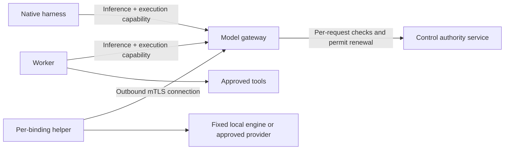

# Sovite: portable, qualified model bindings (remote model hosting)

Status: **accepted 2026-10-20** (operator delegated the decision; every §15 recommendation accepted).
PR 1 (v1alpha2 schema, database schema 2) shipped as Sovite 0.1.10 (`cabf7a8`). PR 2 (connector protocol,
helper-signed-v1 identity, development-only pilot helper; independently reviewed, findings fixed) shipped as
0.1.13 (`90a3316`); both deployed on appservice. Next: PR 3, gateway and execution authority (in progress).
Planner: Codex, read-only, from Sovite `d192717`. Source brief sha256 prefix `13b608c83847f3c5`; links rewritten as `repo:path`.

**Decision-complete design brief — portable, qualified model bindings**

Planning mode: **single**, implemented through sequential PRs. Interfaces are not yet frozen enough for wave dispatch.

This brief follows `agentops:skills/dispatch-plan/SKILL.md` and inspects local source at `d192717`. No Sovite dispatch manifest, overlay, repository planning guide, or `.claude/gates.json` was found. No routing assignments are inferred from another repository.

I made no repository changes and ran no deployment or qualification tests. A concurrent edit appeared in `network.yaml` during inspection; it is left untouched and treated as transitional work.

**1. Goal and scope**

An operator can bind inference served in-cluster, on a workstation, on a rented machine, or through a provider API. Each binding declares its placement, trust tier, retention, serving protocol, identity requirements and operational bounds. Sovite admits tasks only when their complete context class can cross every declared destination.

The final inference path is:



The helper initiates the connection; inference requests travel back over that established connection. It supplies no IP tunnel, socket forwarding, proxy service, or route into the cluster.

The accepted decisions remain fixed:

- Helpers dial outward to the in-cluster gateway using per-binding mTLS identities.
- There is no implicit fallback, endpoint substitution or model substitution.
- Sovite exposes demand; it does not provision machines.
- Any optional WireGuard/Tailscale transport remains userspace-only inside the gateway pod. It must not install routes or expose a forwarding interface.

Phase 0 is an external dependency, not implementation scope. Its temporary proxy and unpinned development bindings are retired in Phase 2.

Out of scope: alternative-placement scheduling, VPS lifecycle management, arbitrary remote execution, tool execution on helpers, hardware attestation, multi-tenant isolation, and gateway high availability.

**2. Component boundaries and phase split**

| Component | Responsibility | Authority and secrets |
|---|---|---|
| Bundle compiler | Resolve bindings; validate classes, placement, retention, identity pins and protocol compatibility | Configuration only |
| Control authority service | Authorize execution and each inference request; manage binding inhibits, enrollment records, fencing and demand | Platform DB; dedicated workload authentication |
| Model gateway | Sole inference egress for workers and native harnesses; enforce request authorization; route to the exact helper session; cancel streams | Workload identity and helper public trust; no artifact-store credentials or CA signing key |
| Enrollment issuer | Issue/renew narrowly scoped helper certificates against approved enrollment records | Dedicated helper intermediate CA; separate from qualification signing |
| Helper | Connect outward; report signed identity; invoke one configured engine/provider; enforce generation deadlines and cancellation | One binding’s key and, where needed, its upstream credential |
| Worker | Own job lease, tool authority, retry safety and result persistence | Existing platform authority |
| Native harness | Run the fixed agent; send provider traffic exclusively through the gateway | Per-execution capability; no platform DB, store or operator credentials |
| External provisioner | Read scoped demand and decide what to start or stop | Demand-reader identity only |

Do not give the gateway the shared runtime environment from `_helpers.tpl`; that currently includes broad platform credentials.

**Phase 1**

Implement the gateway, authority protocol, schema, signed identity contract, availability/error handling and cancellation semantics. Exercise the connector protocol with an in-cluster pilot helper using preprovisioned per-binding credentials. This is a small vertical implementation of the final transport, not a temporary inbound-helper design.

**Phase 2**

Package the standalone helper for external hosts; complete enrollment, renewal, rotation and revocation; expose demand; qualify remote host classes; remove Phase 0.

A Phase 1 in-cluster deployment can become enforced independently. Remote placement acceptance is complete only after Phase 2.

**3. Named invariants**

These names should appear in code comments, tests and evidence.

| Invariant | Required property |
|---|---|
| `EXACT_BINDING` | A job retains its generation and model binding. No fallback or automatic migration to another binding |
| `INFERENCE_ONLY` | Helpers can exchange only the connector protocol and responses to gateway-issued inference requests |
| `NO_REVERSE_ROUTE` | The connector exposes no mechanism to initiate connections into cluster or protected LAN services |
| `CURRENT_AUTHORITY` | Every inference request checks current job, generation, grant, binding, qualification and lease authority |
| `LEASE_FENCED` | A request belongs to one execution fence; an old worker or session cannot continue after replacement |
| `PIN_BEFORE_PROMPT` | Enforced inference sends no prompt until signed identity matches the qualified pins |
| `SESSION_IDENTITY` | A request remains bound to one helper session, engine/model epoch and recorded host instance |
| `BOUNDED_STOP` | Cancellation, authority expiry and lost connectivity stop generation within the qualified bound |
| `NO_TRANSPARENT_REPLAY` | Neither gateway nor helper replays inference after a disconnect |
| `RELEASE_RECHECK` | Artifact persistence and caller release retain the existing independent authority checks |
| `AVAILABILITY_NOT_COMPETENCE` | Host absence, preemption and connector failures do not count as model competence failures |

Authorization has a defined linearization point: the control transaction granting a request permit. Bytes already transmitted cannot be recalled. Withdrawal after that point is governed by permit expiry and the cancellation bound.

**4. Gateway–helper wire protocol**

Use **WebSocket over TLS**, subprotocol `sovite-inference.v1`, with TLS 1.3 and client certificates.

This fits outbound NAT traversal and bidirectional cancellation while preserving existing inference bodies and SSE streams. It avoids introducing a generic HTTP/TCP tunnel. The same protocol serves the Phase 1 pilot and Phase 2 standalone helper.

The external listener terminates TLS at the model gateway through L4 passthrough. The helper terminates the other end. Any hop from helper to engine is separately constrained: Unix socket/loopback for a local engine, validated HTTPS for a provider. An ingress-generated identity header is insufficient.

**Protocol contract**

Each connection serves exactly one enrolled binding. Initially allow one active helper session and one concurrent inference request per binding. A second live connection is rejected; replacement requires explicit fencing of the old session.

Messages have strict schemas, a protocol version, session ID, monotonic sequence number and bounded length.

| Direction | Message | Purpose |
|---|---|---|
| Gateway → helper | `challenge` | Fresh nonce and expected binding/configuration |
| Helper → gateway | `hello` | Signed identity, protocol capabilities, instance and engine/model epoch |
| Both | `heartbeat` | Liveness, engine readiness and current epoch |
| Gateway → helper | `prepare` | Reserve the exact session/epoch for a request, without prompt bytes |
| Helper → gateway | `prepared` | Signed request-scoped identity and reservation |
| Gateway → helper | `invoke` | Approved operation, inference body, deadline and short-lived generation permit |
| Helper → gateway | `accepted`, `chunk`, `complete`, `error` | Correlated inference response |
| Gateway → helper | `permit`, `cancel` | Renew generation authority or stop it |
| Helper → gateway | `cancelled` | Acknowledge observed generation termination |
| Helper → gateway | `renew_csr` | Request renewal of its own enrollment certificate |

No generic method, destination URL, arbitrary header map, `CONNECT`, file operation, shell command or helper-originated request is permitted.

The gateway selects the operation from a fixed allowlist:

- OpenAI-compatible Chat Completions.
- OpenAI-compatible Responses, including qualified streaming and continuation behavior.
- Ollama chat where retained by an explicit adapter.

It preserves inference bodies and SSE event boundaries. It does not translate Responses into Chat Completions. The compiler enforces `tool-agent → chat` and native Codex `→ responses`.

Provider-side tools, hosted execution, background generation and remote URL fetching are denied unless separately supported and qualified. Model-generated tool calls remain untrusted response data; only the worker or harness may act on them.

**Bounds and failure handling**

- Control frames: maximum 64 KiB.
- Inference body/result: initially retain the existing 4 MiB result ceiling; use explicit request limits.
- Chunk size: maximum 64 KiB, with bounded buffering and backpressure.
- Disable WebSocket compression and payload access logging.
- Reserve capacity for cancellation and permit messages so output backpressure cannot starve them.
- Reject unknown messages, duplicate IDs, out-of-order sequence numbers and unsolicited responses.
- Reconnect creates a new session. It never resumes an interrupted generation.
- Retry decisions belong to the worker, never the transport.

**5. Engine-agnostic identity**

Replace the Ollama-only identity dependency with `helper-signed-v1`.

A signed assertion contains:

- Installation, binding, enrollment ID and enrollment role.
- Helper image digest.
- Engine image digest and engine version.
- Model identifier and engine/model load epoch.
- Weight-file names, sizes and SHA-256 hashes.
- An aggregate digest over the canonical weight-file manifest.
- Host instance ID, engine process instance and helper session ID.
- Supported wire APIs and cancellation mechanism.
- Gateway challenge, issuance/expiry times and, for `prepared`, request ID and private request-body digest.

Use Ed25519 with the enrolled helper key. Sign a domain-separated canonical encoding; accept only bounded strings, integers, booleans, arrays and objects. Reject duplicate keys, noncanonical encoding and ambiguous numeric values. Publish protocol vectors.

For a single GGUF, record its actual file hash. For multiple files, record every file hash and the aggregate manifest digest. **Do not relabel an Ollama model-manifest digest as a weight-file hash.**

Verify identity:

1. At helper connection.
2. During request preparation, before prompt delivery.
3. Against the same engine/model epoch through completion.

The helper must reserve the loaded model for the request or obtain an equivalent engine guarantee. For llama-swap, a model-name response alone is insufficient. A changed load epoch terminates the request as preempted; it cannot silently continue against the replacement model.

Enforced mode requires matching pins. Development mode may declare `unpinned-development`, prominently visible in operator views and artifacts.

Signatures establish **which enrolled helper made the assertion**. They do not establish that an uncompromised process executed those weights. Preserve this limitation in `SECURITY.md`.

Store assertions and their verification results in private job evidence, including failed/cancelled attempts. Completed artifacts include the instance, helper/engine digests, engine version, weight digests, session and request IDs.

**Provider boundary**

A provider API may expose only a mutable model name, omit weight identity, or continue generation after disconnect. The helper must report those facts explicitly.

Such a provider is usable in declared development mode. It cannot become enforced by hashing a model name, using a null digest, or signing an unverifiable claim as “verified.” Enforced provider support requires identity and cancellation evidence that meets the same contract. This is a capability limit, not a fallback path.

**6. Bundle schema**

Introduce `sovite.platform/v1alpha2`. Do not silently add placement defaults to old bundles.

Keep `models` as the existing binding objects; agents continue referencing a model binding by ID. Add `connector_roles` and extend destinations/models.

| Area | Fields and rules |
|---|---|
| Destination | Required `trust_tier`: `operator-owned`, `rented`, `provider`; required retention declaration |
| Restricted threshold | Root `restricted_class` reference, normally `C3`; compare by class rank |
| Rented restricted clearance | Explicit `restricted_clearance` naming classes, rationale and operator policy reference |
| Connector role | Destination, expected helper image digest and engine image digest |
| Model binding | Gateway connection, enrollment role, signed identity pins, supported wire API, enabled flag, concurrency and host-specific deadlines |
| Grant | Existing `on_outage: queue`; add finite `availability_wait_seconds` |
| Runtime state | Binding inhibit is operational state, separate from bundle `enabled` and observed availability |

Illustrative fragment; repeated digests are placeholders, not deployable pins:

```yaml
apiVersion: sovite.platform/v1alpha2
kind: PlatformBundle
mode: enforced
restricted_class: C3

destinations:
  - id: rented-inference
    kind: cloud
    clearance: C2
    trust_tier: rented
    retention:
      prompt_logging: false
      response_logging: false
      persistent_context: false
      in_memory_cache:
        scope: job
        max_seconds: 300
        clear_on_cancel: true
        clear_on_session_close: true

connector_roles:
  - id: rented-llamacpp
    destination: rented-inference
    helper_image_digest: "sha256:1111111111111111111111111111111111111111111111111111111111111111"
    engine_image_digest: "sha256:2222222222222222222222222222222222222222222222222222222222222222"

models:
  - id: rented-chat
    adapter: openai-compatible
    wire_api: chat
    model: approved-reasoner
    destination: rented-inference
    enabled: true
    connection:
      kind: model-gateway
      enrollment_role: rented-llamacpp
    identity:
      protocol: helper-signed-v1
      pinning: required
      engine_version: approved-engine-version
      weights_manifest_digest: "sha256:3333333333333333333333333333333333333333333333333333333333333333"
    max_concurrency: 1
    timeout_seconds: 120
    first_token_timeout_seconds: 60
    cancel_bound_seconds: 6
```

An intentional restricted-data clearance on that rented destination additionally requires:

```yaml
clearance: C3
restricted_clearance:
  classes: [C3]
  rationale: Explicitly cleared rented inference placement
  authorization_ref: restricted-inference-policy
```

A grant’s availability policy is explicit:

```yaml
on_outage: queue
availability_wait_seconds: 900
max_attempts: 3
timeout_seconds: 600
```

**Compiler decisions**

- Compute effective context from input, declared output and every permitted tool result, preserving the current class rules.
- Require model binding and connector role to name the same destination.
- Reject restricted-or-higher context on rented destinations without explicit clearance, even when ordinary destination clearance is high enough.
- Require retention declarations for every receiving destination. For inference, prompt/response logging and persistent context must be disabled.
- Treat cache scope and lifetime as qualified operational declarations; a YAML value is not evidence of enforcement.
- Provider retention declarations cover the upstream provider as well as the helper.
- Reject unsupported identity, missing enforced pins, wire API mismatches and ambiguous legacy/new identity fields.
- Gateway bindings contain no worker-selectable upstream endpoint or provider credential.
- Include all placement, retention, identity, timeout and clearance fields in generation calculation and flow projections.

Retain a development-only legacy reader during migration. Enforced `v1alpha2` has no direct-model endpoint escape hatch. Remove Phase 0-specific compatibility in Phase 2.

“New binding needs bundle changes only” means no Python adapter change, chart customization, worker egress change or per-host IP rule. Enrollment, supplying the helper’s local configuration and collecting qualification remain necessary operational steps.

**7. Per-request authority, including native Codex**

Add a private, workload-authenticated authority API. Helper identities are issued by a separate CA/intermediate and are never accepted as workload identities.

On job claim, create a fresh execution fence and a random, short-lived execution capability. Bind it to:

- Job and generation.
- Actual grant and caller context.
- Model binding.
- Execution fence and lease owner.
- Permitted worker/native-harness identity.
- Attempt deadline.

Store only the capability digest. Never send this capability, caller identity or grant credential to the helper.

For each request the gateway asks control to authorize:

1. Capability and authenticated workload identity.
2. Job is running under the exact, unexpired execution fence.
3. No cancellation request.
4. Current generation, grant, caller authority and qualification.
5. Binding enabled, uninhibited, and cleared for resolved context.
6. Exact helper session, enrolled identity and qualified pins.
7. Request operation, body limit, deadline and binding concurrency.

The control service records the request authorization and returns a short-lived permit. The gateway renews it while streaming. Missing control authority fails closed.

**Native integration**

- Extend `/run` with execution context and capability.
- Retain the service’s fixed agent identity.
- Obtain/validate the exact execution recipe through a narrow control endpoint; stop selecting the first grant for an agent.
- Configure Codex with a task-scoped gateway base URL and capability supplied through its reduced environment.
- Prevent configured provider endpoints or ambient provider credentials from bypassing this route.
- Preserve `wire_api=responses` and the disabled web-search setting.
- Propagate bounded gateway error codes through `/run`; do not collapse every failure into generic HTTP 502.
- Key the native ledger by job plus execution fence. Repeating the same fence is idempotent; a new fence requires an explicit control-authorized retry.

Native harnesses receive neither platform DB access nor the ability to mint capabilities. NetworkPolicy permits their inference traffic only to the gateway.

**8. Availability, leases, retries and cancellation**

**Availability**

Expose `online`, `starting`, `offline` per binding, with separate enabled/inhibited/qualified conditions, reason code, observation time and session/instance references.

- `online`: authenticated, healthy helper; matching identity; qualified serving/cancellation behavior.
- `starting`: authenticated startup/warmup report with an expiry.
- `offline`: absent/stale session or unusable engine. Preserve a specific private reason such as identity mismatch or revocation.

Capacity is separate from availability; busy is not offline.

Initial protocol constants:

| Bound | Value |
|---|---:|
| Helper heartbeat interval | 2 seconds |
| Session freshness | 6 seconds |
| Known-offline request rejection | ≤2 seconds |
| Dead-session detection and request failure | ≤8 seconds |
| Generation permit lifetime | 3 seconds |
| Authority renewal interval | 1 second |
| Local engine stop after permit loss/cancel | ≤2 seconds |
| Qualified end-to-end cancellation bound | ≤6 seconds |

The six-second bound includes permitted clock skew, scheduling and engine stop. Qualification must establish it under the declared load. A host that misses it is not qualified at that bound.

The helper uses a local watchdog. Losing the gateway or authority renewal expires generation permission even when no cancellation message arrives.

**Job state and attempts**

Keep existing public receipt statuses. Availability details stay on private operator surfaces.

- Admission may queue an authorized job while its binding is unavailable, creating demand.
- Offline jobs remain `queued` or `retry_wait`, with `model_host_unavailable` and a finite availability deadline.
- Do not claim them repeatedly or increment execution attempts merely to discover that no session exists.
- Claiming creates a fence and dispatch record. Reserve the exact helper session before launching the harness.
- Increment execution attempts when actual harness execution starts. A reservation failure before that point does not burn an attempt.
- Once execution starts, a host failure consumes that attempt and follows retry policy.
- Reconnects and retries never reset an attempt’s execution deadline.
- The availability deadline is fixed from submission; reconnects do not extend it indefinitely.

A reservation is not a future-authority grant. First inference still requires current authorization.

**Error semantics**

| Code | Meaning | Handling |
|---|---|---|
| `model_host_unavailable` | No usable session, connection loss, engine absent, or upstream unavailable | Fast response; queue only within availability/attempt policy |
| `model_host_preempted` | Established request lost its reserved engine/model epoch | Retryable only when whole-job replay is safe |
| `model_identity_unpinned` | Enforced identity lacks required pins | Block; no inference |
| `model_identity_mismatch` | Signed identity differs from qualified binding | Quarantine session; block |
| `model_protocol_error` | Malformed connector/inference exchange | Fail request; quarantine where warranted |
| `model_cancel_unconfirmed` | Stop was not confirmed within bound | Record uncertainty; quarantine binding |
| Existing authority codes | Cancel, inhibit, superseded generation, expired qualification or lease | Stop; never treat as host outage |

Preemption requires an engine signal or observed epoch change. Do not infer it from every 5xx response.

For retry safety, preserve existing conservative rules:

- Read-only tool execution may restart within policy.
- Potentially effectful or uncertain work remains blocked unless durable idempotency proves replay safe.
- A helper cannot declare a job replay-safe.
- Native uncertainty remains uncertainty unless its ledger and side-effect model establish otherwise.
- Neither host-unavailable nor host-preempted outcomes enter competence-failure totals.

**Cancellation and fencing**

Cancellation, grant inhibit, binding inhibit/disable, generation replacement, certificate revocation and lease loss all invalidate active inference authority.

The gateway closes downstream streams and sends `cancel`. The helper closes the engine request, invokes a qualified abort mechanism and, where necessary, stops its supervised engine process. Acknowledgment means generation was observed stopped.

Binding inhibit/disable closes its helper session. Grant inhibit stops affected requests; it need not close an unrelated binding session.

Late frames and results are discarded after fence invalidation. Existing finalization and caller-release checks remain mandatory.

For engines/providers that cannot demonstrate bounded stop, disconnect is recorded as best effort; it cannot satisfy enforced cancellation qualification.

**Persistence**

Introduce an explicit schema migration and compatibility check; `create_all()` alone cannot migrate existing tables.

Persist execution fences, request ledgers, enrollment/revocation records, binding runtime state, availability deadlines and private identity/cancellation evidence. Test SQLite and PostgreSQL upgrades. Old workers must refuse the upgraded execution schema.

Gateway restart invalidates its sessions and permits. Worker recovery remains responsible for determining replay safety.

**9. Enrollment, rotation and revocation**

An enrollment authorizes **one binding**, one enrollment role and one helper public key.

- Helper generates its key locally.
- Initial enrollment uses an operator-mediated CSR exchange. Do not expose an unauthenticated enrollment listener.
- The operator creates the enrollment against the declared binding/role; the issuer returns a certificate and gateway trust bundle.
- Certificate identity includes installation, binding and enrollment IDs. Role comes from the issuer’s record, not a self-selected CSR field.
- Reject cross-installation, cross-binding and revoked enrollments.

Leaf certificates last 24 hours; renew around 12 hours with jitter. Renewal travels over the authenticated connector and requires a still-valid enrollment and active binding.

For key rotation, issue a replacement certificate after proof of possession. Activate the new session only after fencing and closing the old one. No session takeover or automatic failover occurs.

Revocation is checked at connection, request authorization and permit renewal. Revoking an enrollment closes its sessions and prevents renewal within the cancellation bound; it does not wait for certificate expiry.

Keep helper CA keys separate from qualification keys. CA rotation uses an explicit trust-overlap period and updated deployment evidence. Ordinary leaf renewal under the same approved enrollment/class does not require model competence requalification.

A changed engine image, helper image, weights, role, trust tier or retention contract changes the qualified host class.

**10. Chart and NetworkPolicy**

Add gateway workload, internal inference Service, external connector listener, narrow authority-service connectivity, enrollment issuer and explicit certificate Secret references.

Final allowed paths:

| Source | Destination |
|---|---|
| Worker | Gateway inference port; existing approved tool/native/state paths |
| Native harness | Gateway inference port; narrow execution-context authority endpoint |
| Helper | Gateway connector listener only through the connector |
| Gateway | Control authority endpoint and necessary restricted DNS |
| Enrollment issuer | Its narrowly scoped control/issuance dependencies |
| Provider connector pod, if in-cluster | Gateway plus the exact approved provider HTTPS destination |

The gateway needs no outbound connection to remote helper addresses. Return traffic uses their established connection.

Remove direct worker/native access to Ollama and `modelPeers`. Preserve tool and harness policies independently. Kubernetes NetworkPolicies are additive: leaving an old allow rule defeats a new restrictive rule.

Additional constraints:

- No `hostNetwork`, privileged container, TUN device, `NET_ADMIN`, Docker socket or service-account token on gateway/helpers.
- Keep gateway ingress distinct from the existing control-plane HTTPS gateway.
- Default-deny ingress and egress remain mandatory.
- Restrict DNS to actual service dependencies.
- Provider connector egress uses exact destination rules, TLS hostname verification and redirects disabled.
- Provider connector policy must also block metadata and unintended private destinations; DNS names alone are insufficient.
- Generate any provider connector resources/rules from the reviewed bundle, rather than maintaining another per-binding chart list.
- Extend `deployment_contract.py`, installer binding calculation, values schema and structural validation for these components.
- Keep site addresses, gateway exposure details and private upstream endpoints in installation configuration, never public examples or evidence.

A compromised helper must not be able to use the protocol to open connections into the cluster or protected LAN. Sovite cannot remove independent routes that an already-compromised host has through its own physical LAN; that broader claim requires host/network administration outside this connector.

**11. Demand signal**

Expose an authenticated, read-only, per-binding demand endpoint under the private operator API.

Use a dedicated `demand-reader` role with a binding allowlist. It cannot inspect jobs, prompts, artifacts, enroll helpers, change bindings, clear inhibits or issue qualifications.

Return:

- Binding ID and generation.
- Availability and observation age.
- Eligible queued/retry-wait job count.
- Running count.
- Oldest eligible queue age.
- Availability deadline information sufficient for provisioning decisions.

Exclude terminal, cancelled, superseded and inhibited jobs. Count work awaiting a sleeping model even while the host is offline.

Treat counts and binding names as operational metadata. Do not include caller identities, task content or private job IDs. Prefer polling with snapshot timestamps; no provisioning webhook or lifecycle controller is required.

A provisioner may optionally report expiring `starting` intent. That signal never establishes online status, identity, qualification or execution authority.

**12. Threat model**

| Threat | Control | Residual limit/evidence |
|---|---|---|
| Helper attempts reverse connections | No forwarding operation; separate listeners/CAs; default-deny cluster ingress | Test raw protocol, HTTP and network attacks |
| Helper claims another binding | Certificate/enrollment binding plus gateway correlation | A stolen binding key compromises that binding |
| Compromised helper requests tools | Protocol has no tool-call execution path or tool credentials | Malicious model output remains untrusted input |
| Prompt sent to insufficiently cleared host | Effective-context compiler checks and current request authorization | Operator labels/clearances remain trusted declarations |
| Rented host receives C3 accidentally | Explicit restricted clearance required by compiler | Host operator/hypervisor may inspect approved traffic |
| Engine/model swapped mid-task | Signed preparation, load epoch reservation and epoch checks | Helper/engine claims are not hardware attestation |
| Native harness continues after inhibit | Gateway checks each provider call and renews active permits | Already transmitted context cannot be retracted |
| Old worker/session continues | Execution and session fences; expiring permits | Requires correct trusted control/gateway implementation |
| Gateway/control partition | Permit watchdog fails closed | Availability is sacrificed to preserve authority |
| Cancellation frame lost | Local permit expiry and qualified engine stop | Opaque provider may be unsuitable for enforced mode |
| Payload retained remotely | No payload logging; declared cache lifecycle; upstream retention evidence | Compromised approved recipient can retain received data |
| Gateway compromise | Minimal credentials, network isolation and per-request control checks | Gateway sees prompts and remains a trusted component |
| Helper floods unsolicited data | Correlation, limits, backpressure, rate limits and quarantine | Denial of service remains possible |
| Provisioner compromised | Read-only scoped demand role | Authorized demand metadata can leak |
| Silent fallback | Immutable binding and no transport replay/substitution | Operator must submit new work after explicit rebinding |

**13. Qualification and verification evidence**

Qualification retains the existing five required deployment check names. Add mandatory connector subchecks rather than accepting a generic “network passed.”

| Existing check | Required new evidence |
|---|---|
| `runtime-identity` | Host-class tuple, signed assertions, actual image/weight observations, session/instance recording |
| `network-isolation` | Sole inference gateway, forbidden-path packet tests, cross-binding/protocol abuse tests, provider isolation |
| `receipt-boundary` | Host details/errors remain private; existing bounded caller surface survives |
| `recovery` | Fences, partitions, restarts, revocation, lease expiry, cancellation bound and uncertain-effect handling |
| `task-competence` | Exact model identity, harness, agent procedure, parameters and tool bindings |

Qualify the host class by enrollment role, helper/engine image digests and weight identity, with trust/retention and transport/cancellation behavior attached. Record the actual instance per session. Replacing an instance with the same qualified class does not require repeating competence tests.

Measure host latency, first-token behavior, timeout and cancellation separately. A fast successful sample is not competence or cancellation evidence.

**Adversarial acceptance**

1. Add a remote binding through bundle activation, enrollment and qualification; demonstrate no code, per-host chart or worker-network edits.
2. From a hostile enrolled helper, attempt arbitrary methods, URLs, `CONNECT`, cluster/LAN targets, another binding ID and unsolicited responses. Observe denials and packet outcomes.
3. Send a C3 context through a permitted C3 tool result to an uncleared rented binding. Compilation must fail.
4. Alter each identity pin, replay a prior challenge and swap weights/load epoch after preparation. No unauthorized prompt delivery.
5. Put both tool-agent and native Codex behind the gateway. Revoke authority between consecutive provider requests and during streaming.
6. Kill/partition helper, gateway, control, worker and engine independently. Confirm bounded outcomes, no fallback and no hidden transport replay.
7. Repeat offline scheduling. Attempts remain unchanged until execution begins; availability waiting expires.
8. Preempt a model mid-task. Confirm `model_host_preempted`, correct replay-safety handling and separate competence accounting.
9. Exercise cancellation, inhibit, disable, revocation, lease loss and permit starvation under output backpressure. Measure engine stop, not merely TCP closure.
10. Attempt replay after a mutating tool. Preserve `execution_uncertain`.
11. Inspect logging, crash behavior and cache cleanup with canary content. Public artifacts must not contain it.
12. Verify private artifacts for completed, failed and cancelled work record the expected instance and engine/weight evidence.

Each guard must be forced into its failure case. “Not run” remains non-passing.

Evidence records include generation, runtime/deployment binding, image digests, host-class identity, test commands, measurements and limitations. Publish sanitized fixtures and summaries; retain site-specific evidence privately.

**Verification commands for implementation**

Existing commands:

```bash
python -m pytest tests/test_policy.py tests/test_backend.py tests/test_deployment.py
python scripts/validate_deployment.py
python scripts/validate_deployment.py --bundle config/platform.kubernetes.yaml
sovite validate config/platform.kubernetes.yaml
```

Add targeted protocol/state tests and a dedicated integration collector, for example:

```bash
python -m pytest tests/test_model_gateway.py tests/test_model_helper.py
python -m pytest tests/test_model_authority.py tests/test_model_lifecycle.py
python scripts/qualify_model_connector.py --scenario all --output <private-evidence-path>
```

The new collector must distinguish local protocol simulation from real host, CNI and engine evidence. Helm-dependent tests must run with Helm installed; skipped tests do not satisfy deployment verification.

Run concurrency/recovery against PostgreSQL and migrations against both supported databases. Use the installation’s explicit cluster context and prescribed kubeconfig for live tests.

**14. Release sequencing**

All PRs are sequentially stacked. Each runtime, chart or documentation change is a release under the stated repository rule. Allocate the next available version at merge time to avoid collision with Phase 0.

| PR | Reviewable scope | Required evidence |
|---|---|---|
| 1 — Schema and migration foundation | `v1alpha2`, trust/retention rules, connector roles, explicit migration and compatibility checks | Compiler negative tests; SQLite/PostgreSQL upgrade tests |
| 2 — Identity and connector protocol | Strict messages, signed identity, protocol vectors, in-cluster pilot helper | Tampering, replay, cross-binding, malformed-frame and epoch tests |
| 3 — Gateway and execution authority | Gateway, capabilities, fences, request ledger, permits | Denied-before-prompt tests; lease and authorization races |
| 4 — Worker/native integration | Gateway routing, native execution context/ledger, safe error propagation | Real Chat and Responses flows; native authority-gap regression |
| 5 — Phase 1 lifecycle and deployment | Availability-aware dispatch, retry accounting, cancellation, chart and network cutover | Packet tests, faults and measured stop bounds; Phase 1 qualification |
| 6 — Phase 2 helper lifecycle | Standalone packaging, enrollment issuer, renewal, rotation, revocation | NAT-host connection; wrong-cert, expiry and revocation tests |
| 7 — Demand and remote qualification | Scoped demand API; host-class evidence tooling | Scope/privacy tests; sleeping-host and external-start scenarios |
| 8 — Phase 0 retirement | Move approved bindings, remove proxy compatibility and direct model rules, revise operating/security documentation | Remote end-to-end qualification and zero-bypass evidence |

Intermediate releases must not advertise unfinished paths as enforced-capable. Prefer staging new components disabled until their authority and network cutover is complete.

For every release, follow the version surfaces demonstrated by `289ae3a`: package metadata, `sovite/__init__.py`, API version declarations, chart version/appVersion, Compose/image tags and packaging defaults. Keep bundle package versions independent unless changed.

Run `scripts/package_release.py`, extract its generated manifest into `RELEASE-MANIFEST.json`, verify archive hashes, and rebuild both runtime and native-codex images. Also build/digest-pin the helper once introduced. Include new source files in packaging checks.

Require independent review of authority/fencing, connector parsing/PKI, and network/retention claims. Review the final result against the product need and named invariants.

**Phase 0 retirement order**

1. Enroll and qualify the replacement helper/binding.
2. Inhibit affected grants and drain or explicitly cancel old work.
3. Activate the reviewed generation; do not migrate existing jobs.
4. Qualify that exact generation and deployment.
5. Remove direct model egress, including transitional CIDR allowances.
6. Revoke/remove proxy credentials and stop the Phase 0 proxy.
7. Prove direct access fails while the helper path works.
8. Resume grants under current qualification.

A rollback must use a complete reviewed release/bundle combination. It cannot silently restore the unpinned proxy as an enforced route.

**15. Open questions and recommended dispositions**

| Question | Recommendation |
|---|---|
| Can the workstation’s exact llama-swap/llama.cpp build reserve identity and stop generation within six seconds? | Measure during qualification. Add a cooperating engine interface or supervised engine isolation if necessary; keep development-only until proven |
| Which provider APIs expose sufficient identity and cancellation semantics? | Add explicit capability declarations and collect provider-specific evidence. Reject enforced use when required properties are unavailable |
| What exposes the gateway’s external listener? | Use the site’s approved L4 service with TLS passthrough; keep topology outside public source |
| Are the initial timeout values suitable for every host? | Keep the authority/permit bounds fixed initially; qualify host-specific inference deadlines from measurements |
| Is gateway HA needed now? | Start with one active gateway. Restart causes visible interruption and worker-governed recovery; defer distributed session ownership |
| Can qualification become granular immediately? | Retain whole-generation qualification. Structure evidence by host class and competence tuple now, allowing explicit reuse in a newly issued generation qualification |

None requires reopening connection direction, fallback policy or provisioning scope.